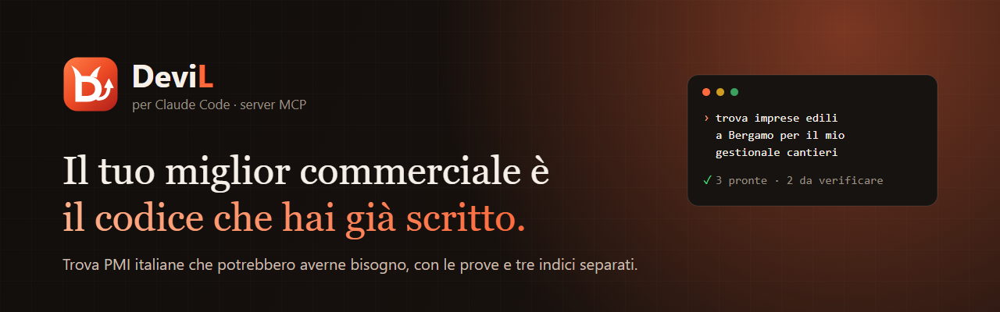
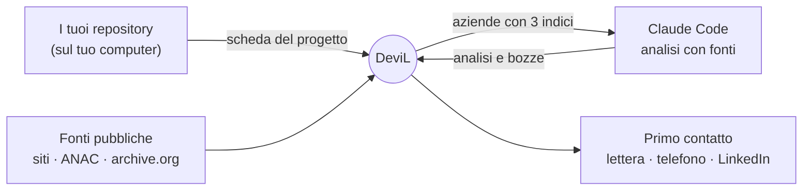

<p align="center">
  <a href="https://devil.vibecanyon.com"></a>
</p>

<p align="center">
  <a href="https://devil.vibecanyon.com"></a>
  
  
  
  
  <a href="LICENSE"></a>
</p>

<p align="center">
  <a href="#collegarlo-in-un-minuto">Collegarlo</a> ·
  <a href="#come-funziona">Come funziona</a> ·
  <a href="#strumenti">Strumenti</a> ·
  <a href="#esempi">Esempi</a> ·
  <a href="#sicurezza-e-privacy">Sicurezza</a> ·
  <a href="#domande-frequenti">FAQ</a> ·
  <a href="#english">English</a>
</p>

---

**DeviL analizza i software che hai già sviluppato, trova PMI italiane che potrebbero averne bisogno e ti aiuta a trasformare il tuo codice in nuove opportunità commerciali.**

Questo repository documenta il **server MCP di DeviL** per **Claude Code**: il tuo Claude Code legge i tuoi repository, cerca le aziende giuste nella tua zona, le analizza con le fonti e prepara il primo contatto nel canale consentito. Tutto con il tuo abbonamento Anthropic, senza installare niente.

> [!NOTE]
> Il server è remoto e gestito da DeviL. Ti servono un account DeviL ([beta su invito](https://devil.vibecanyon.com/#invito)) e un token personale.

## Perché DeviL

- **Parti da quello che hai già costruito.** Un gestionale, un'app, un portale che funzionano si vendono meglio di una promessa: caso reale, demo, tempi certi.
- **Un indizio non è un bisogno.** Ogni azienda arriva con tre indici separati: **Opportunità** (quanto è probabile il problema), **Adatta a te** (quanto un tuo software lo risolve) e **Affidabilità** (quanto sono solide e recenti le prove). Con prove deboli è «da verificare», non «pronta».
- **Fatti, non supposizioni.** Segnali dai siti aziendali, open data ANAC su appalti e attestazioni SOA, storia del sito su archive.org: ognuno con la prova di dove è stato trovato. Claude cerca in rete, cita le fonti e verifica le date.
- **Dentro le regole italiane.** Email e WhatsApp solo con consenso o rapporto in essere (art. 130 Codice Privacy), telefono con la verifica del Registro delle Opposizioni, niente PEC per proposte commerciali. DeviL blocca il resto.
- **Il tuo codice resta tuo.** Claude Code legge i repository sul tuo computer: a DeviL arriva solo la scheda del progetto.

## Collegarlo in un minuto

1. In DeviL apri **Impostazioni → Claude Code e API** e crea un token (inizia con `cbs_`).
2. Nel terminale:

   ```bash
   claude mcp add --transport http --scope user devil https://devil.vibecanyon.com/api/mcp --header "Authorization: Bearer cbs_IL_TUO_TOKEN"
   ```

3. Apri Claude Code e scrivi: *«Usa DeviL: dammi la panoramica e le prossime mosse.»*

Guida passo passo con le schermate: <https://devil.vibecanyon.com/guida/claude-code>.

<details>
<summary>Altri client MCP (configurazione JSON)</summary>

Per i client che usano un file di configurazione con server remoti HTTP:

```json
{
  "mcpServers": {
    "devil": {
      "type": "http",
      "url": "https://devil.vibecanyon.com/api/mcp",
      "headers": { "Authorization": "Bearer cbs_IL_TUO_TOKEN" }
    }
  }
}
```

</details>

## Come funziona



1. **Insegna a DeviL cosa sai fare.** Claude Code legge i tuoi progetti e salva una scheda per ognuno: cosa fa, per chi, funzioni, settori, maturità.
2. **DeviL cerca e legge.** Trova le aziende nelle province che scegli, legge i loro siti e i dati pubblici, controlla che l'attività esista ancora.
3. **Claude analizza e prepara la mossa.** Cerca ogni azienda in rete con le fonti, stima i tre indici, scrive lettera, traccia telefonica o messaggio LinkedIn con i tuoi casi reali.
4. **Tu decidi e impari.** Dopo il contatto registri se il problema c'era: i riscontri correggono la valutazione e mostrano quali segnali indovinano.

## Strumenti

I livelli sono cumulativi: ogni livello comprende gli strumenti dei precedenti.

| Strumento | Da livello | Cosa fa |
|---|---|---|
| `panoramica` | Base | Situazione dell’organizzazione su DeviL: piano e limiti, zona, numeri (aziende, analizzate, bozze pronte, in coda) e le prossime 10 mosse consigliate. |
| `cerca_aziende` | Base | Cerca fra le aziende dell’organizzazione con filtri (testo, provincia, settore, priorità minima (0-100), distanza, solo con bozze pronte, analizzate o no). |
| `scheda_azienda` | Base | Dossier completo di un’azienda in Markdown: dati, persone e canali ammessi, segnali, dati pubblici (ANAC, archive.org), date dei contenuti, testo del sito. |
| `dossier_da_lavorare` | Base | Scarica i dossier delle aziende messe in coda per Claude (più, se top > 0, le migliori non ancora analizzate) con il README: regole di scrittura, catalogo, verifica delle date, ricerca in rete e formato dei risultati. |
| `invia_risultati` | Base | Invia analisi e bozze per una o più aziende (stesso formato di results.json descritto nel README dei dossier: { "version": 1, "items": [...] }). |
| `metti_in_coda` | Base | Mette un’azienda in coda per Claude, con canale e indicazioni facoltative (es. "proponi l’app rapportini"). |
| `azienda_crea` | Base | Aggiunge un’azienda a mano (es. una segnalazione, un contatto di una fiera): stessi controlli del portale. |
| `avvia_ricerca` | Base | Avvia la ricerca di nuove aziende in una o più province (sigle, max 8). |
| `offerte_elenco` | Search | «Le mie offerte»: servizi, prodotti e cataloghi che l’organizzazione vende, con quante aziende sono adatte a ognuna. |
| `offerte_salva` | Search | Crea o aggiorna un’offerta in «Le mie offerte» (con id = aggiornamento). |
| `abbinamenti` | Dev | Abbinamenti fra i progetti del portfolio e le aziende analizzate: per un progetto (slug) le aziende con aderenza e livello (pronto, da adattare, da scalare); senza slug i 5 colpi più facili e la classifica dei progetti per opportunità individuate. |
| `formato_schede` | Dev | Formato delle schede progetto e valori ammessi (settori, tipi di software, temi, stati) con un esempio: leggilo prima di portfolio_salva. |
| `portfolio_elenco` | Dev | Le schede dei progetti già caricate (anche le bozze): leggile prima di inviarne di nuove, per non duplicarle (stesso slug = aggiornamento). |
| `portfolio_salva` | Dev | Inserisce o aggiorna (per slug) fino a 50 schede progetto lette dai repo locali. |
| `cantieri_da_lavorare` | Build | Cantieri di sviluppo messi in coda dall’utente su DeviL (un software da costruire a tappe). |
| `aggiorna_cantiere` | Build | Aggiorna su DeviL un cantiere di sviluppo: avanzamento, cosa è stato fatto, prossima tappa, cartella, ultimo commit ed eventuale domanda per l’utente. |
| `pubblica_demo` | Build | Mette online sullo spazio demo di DeviL la demo statica di un cantiere, per mostrarla all’utente e ai suoi clienti. |

Descrizioni complete e parametri: **[docs/strumenti.md](docs/strumenti.md)**.

| Livello | Prezzo | Cosa aggiunge |
|---|---|---|
| **Base** | 39 €/mese | Ricerca delle aziende, segnali e indici, dossier, coda per Claude, analisi e bozze |
| **Search** | 89 €/mese | Le tue liste e «Le mie offerte», con le aziende adatte a ciascuna |
| **Dev** | 149 €/mese | I tuoi progetti come schede e gli abbinamenti con le aziende |
| **Build** | 299 €/mese | Cantieri: Claude Code costruisce a tappe il software richiesto, con la demo |

Prezzi finali (regime forfettario, IVA non applicata). Durante la beta l'uso è gratuito; i fondatori hanno −30% per sempre. Dettagli: <https://devil.vibecanyon.com/prezzi>.

## Esempi

- **[examples/comandi.md](examples/comandi.md)**: richieste tipiche da scrivere a Claude Code, dal primo giro al lavoro in ascolto con `/loop`.
- **[examples/CLAUDE.md](examples/CLAUDE.md)**: un CLAUDE.md di esempio per lavorare con DeviL nei tuoi progetti.
- **[docs/scheda-progetto.md](docs/scheda-progetto.md)**: il formato della scheda che Claude Code salva per ogni progetto.

```text
› Leggi questo progetto e salvalo in DeviL come scheda.
› Chi sono le aziende più adatte al mio gestionale-cantieri? Mostrami le prime 10 con il perché.
› Lavora la coda DeviL: analisi con fonti e date verificate, poi una lettera per ciascuna.
```

## Sicurezza e privacy

- Il token si crea e si revoca da DeviL; DeviL ne conserva solo l'impronta (SHA-256).
- Ogni token dà accesso solo agli strumenti del tuo livello e ai dati della tua organizzazione.
- Il codice dei repository non viene trasmesso: solo la scheda del progetto.
- Server e database in Italia. Chiavi di terze parti cifrate (AES-256-GCM).
- Solo fonti pubbliche, nessuna raccolta automatica dai social, nessun invio di massa.

Dettagli: <https://devil.vibecanyon.com/sicurezza> · Segnalazioni: [SECURITY.md](SECURITY.md).

## Domande frequenti

<details>
<summary><b>Devo installare qualcosa?</b></summary>

No. Il server è remoto: basta il comando `claude mcp add` con il tuo token.
</details>

<details>
<summary><b>Serve un abbonamento Anthropic?</b></summary>

Per Claude Code sì, perché usa il tuo account. DeviL non aggiunge costi AI: ricerca, segnali, indici, CRM e pipeline funzionano anche senza Claude.
</details>

<details>
<summary><b>Claude Code può mandare email da solo?</b></summary>

No. Gli strumenti preparano analisi e bozze; ogni invio parte da te, uno alla volta, dopo i controlli privacy e solo nei canali ammessi.
</details>

<details>
<summary><b>Funziona fuori dalla Lombardia?</b></summary>

Sì, in tutte le province italiane.
</details>

<details>
<summary><b>Posso usare il server senza account DeviL?</b></summary>

No: il server lavora sui dati della tua organizzazione. Richiedi un invito su <https://devil.vibecanyon.com>.
</details>

## English

**DeviL** is an Italian B2B SaaS that matches the software you have already built with Italian SMEs that may need it, using public data only (company websites, ANAC open data, archive.org). This repository documents its **remote MCP server** for **Claude Code**: add it with the command above using a personal token from *Impostazioni → Claude Code e API*. Every company comes with three separate indices (opportunity, fit, evidence confidence), Claude researches with cited sources, and outreach is limited to the channels allowed by Italian direct-marketing rules. Your source code never leaves your machine: only a project card is sent. Tools and examples are in Italian.

## Licenza

La documentazione e gli esempi di questo repository sono rilasciati con licenza [MIT](LICENSE). Il servizio DeviL, il suo codice e il nome e il logo «DeviL» non sono coperti da questa licenza.

---

<p align="center">
  Un progetto di <b>Luca Porro</b> · <a href="https://devil.vibecanyon.com">devil.vibecanyon.com</a> · <a href="mailto:devil@vibecanyon.com">devil@vibecanyon.com</a>
</p>
